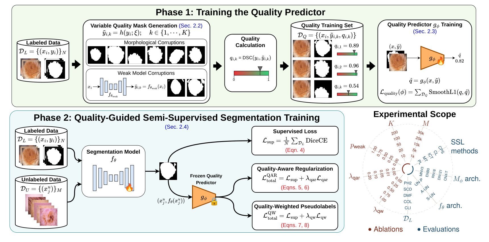
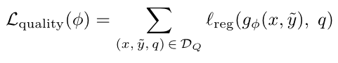
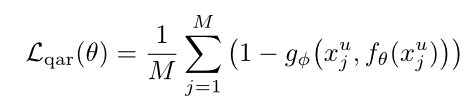
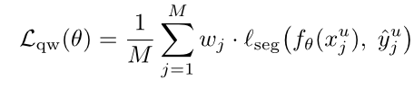
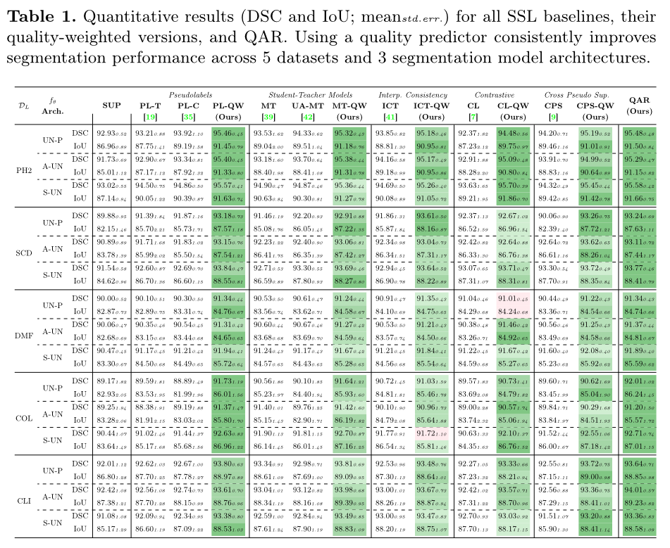
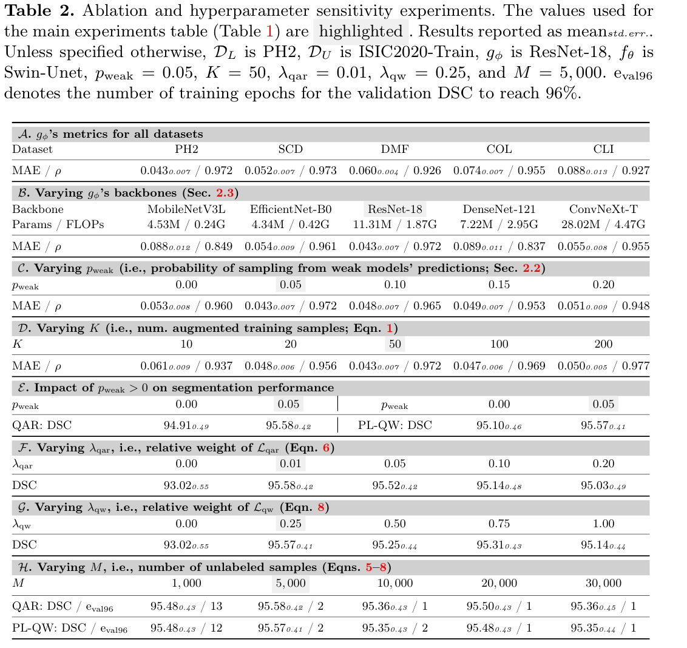

# Highlights

- external segmentation quality estimation (not self-referential) : different from model confidence or uncertainty.
- Two phases
    - (1) Train a segmentation quality predictor $$g_{\phi}$$
    - (2) Freeze it and guide the semi-supervised training of the segmentation model $$f_{\theta}$$
- Applicable to any segmentation model trained with a semi-supervised learning approach. 
- Github repo associated with the paper : [https://github.com/sfu-mial/QG-SSL](https://github.com/sfu-mial/QG-SSL)

# Introduction

- The goal is to train a segmentation network $$f_\theta$$.

- A small subset $$D_L$$ of the available data is labeled, but remaining subset $$D_U$$, though beeing much larger, is unlabeled.

-  No a priori on the distance between $$D_L$$  and $$D_U$$ (they are built from different sources in the experiments).

- A "2 stages" semi-supervised strategy is proposed :
    - (1) Train a segmentation quality predictor $$g_{\phi}$$
    - (2) Freeze it and guide the semi-supervised training of the segmentation model $$f_{\theta}$$
- Applicable to any segmentation model trained with a semi-supervised learning approach. 
 

# Methods


## Data

---

Labeled dataset
$$D_L = \left\{(x_i,y_{i}) | i\in[1,N]\right\}$$

where $$$x_i$$ is an image and $$y_i$$ is its ground truth binary segmentation mask.

---

Unlabeled dataset 
$$D_U = \left\{(x^u_j) | j\in[1,M]\right\}$$ 

with ($$M>>N$$)

---

A third dataset $$D_Q$$ is generated from $$D_L$$ by creating $$K$$ degraded masks from each ground truth binary mask $$y_i$$. 

The $$K=50$$ different degraded versions of each segmentation mask $$ y_{i} $$ are indexed as $$ \tilde{y}_{i,k} $$.

Two types of processes can generate a degraded version of the segmentation mask:

- Synthetic corruption (morphomath) : erosion/dilation with different kernel sizes), translations, elastic deformations, additive noise, and boundary perturbations.
- Weak model predictions : imperfect predictions from various U-Nets stopped early during their training (epoch 1, 3, 5, 10, 15, 30) => early training failure patterns.

The Dice Score is used as a quality score $$q_{i,k} = DSC(y_i, \tilde{y_k})$$


Each sample of $$D_Q$$ is a triplet :
$$D_Q = \left\{(x_i,\tilde{y}_{i,k},q_{i,k}) | i\in[1,N], k\in[1,K]\right\}$$
with
$$x_i$$ the $$i-$$th input image
$$\tilde{y}_{i,k}$$ the $$k-$$th degraded mask made from $$y_i$$
$$q_{i,k}$$ the quality score of $$\tilde{y}_{i,k}$$

--- 

All datasets are split 70:10:20 for train, validation, and test.

## Models

A _segmentation quality_ predictor $$g_{\phi}(x, \tilde{y})$$ is trained on $$D_Q$$.
5 backbones were tested (MobileNetV3L, EfficientNet-B0, **ResNet-18**, DenseNet-121, ConvNeXt-T)
**ResNet-18** was selected (see ablation study).

N.B: $$g_{\phi}(x, \tilde{y})$$ takes as input a pair (image, mask) = $$(x, \tilde{y})$$ and predicts a quality score $$\tilde{q}$$

A segmentation model $$f_{\theta}(x)$$ is trained on $$D_L \cup D_U$$.
3 backbones are compared :
- U-Net++ (UN-P) : 26.08M parameters, 14.14 GFLOPs
- Attention U-Net (A-UN): 24.71M params, 6.16 GFLOPs
- Swin-U-net (S-UN): 34.27M params, 7.55 GFLOPs),
  

## Training strategy


Figure 1 : pipeline overview from the original paper.

### Training of $$g_\phi$$

Trained for 150 epochs (all optimizer details are given in the paper) 

Channel-wise concatenation of image-mask pairs.

``` python
    quality_input = torch.cat([image, mask_input], dim=1)
```
From l.252 on their [losses.py](https://github.com/sfu-mial/QG-SSL/blob/main/training/losses.py#L252) file.

Unless the default value is changed, the semi-supervision is done with batches containing a balanced amount of labeled and unlabeled samples (8 of each). This is not mentioned in the paper, but it can be checked on their [train_semisup.py](https://github.com/sfu-mial/QG-SSL/blob/main/training/train_semisup.py#L254) file : 
``` python
    parser.add_argument("--batch_size_labeled", type=int, default=8)
    parser.add_argument("--batch_size_unlabeled", type=int, default=8)
```

During the training of $$g_{\phi}$$ samples are taken with probability $$p_{weak}=0.05$$ from the weak-model predictions and $$1-p_{weak}$$ from morphomath corruptions.

Quality Predictor $$g_\phi$$ training by Minimizing SmoothL1 loss (regression task) : $$ l_{reg} $$ is SmoothL1 in Equation (3) of the paper.




### Training of $$f_{\theta}$$

$$g_{\phi}$$ is frozen during the training of $$f_{\theta}$$

> Once trained, $$g_{\phi}$$ is frozen and acts as a differentiable quality assessment function for any image-mask pair without requiring ground truth.

---
Supervised part of the global loss : Optimizing Dice + cross-entropy loss (DiceCE) (see Figure 1)

$$L_{sup} = \sum_{N=1}^{N} l_{seg}(f_\theta (x_i), y_i)$$

with $$l_{seg}$$ the combo of Dice + cross-entropy loss (DiceCE).

--- 
Unsupervised part of the global loss has two variants :

1) QAR : Quality-Aware Regularization



$$g_\phi$$ guides the weight updates of $$f_\theta$$.

Indeed, to minimize $$L_{qar}$$, $$f_\theta$$  must generate segmentation masks that, if input to $$g_{phi}$$, will be given a high quality score.


2) QW : Quality-Weighted (Pseudolabels)



The $$l_{seg}$$ loss is the same as for the supervised term : Optimizing Dice + cross-entropy loss (DiceCE)

$$w_j = q_j$$ => weight the samples with their quality score.

--- 

It results in two versions of the Global loss term :

$$ L_{total}^{QAR} = L_{sup} + \lambda_{qar} L_{qar} $$


$$ L_{total}^{QW} = L_{sup} + \lambda_{qw} L_{qw} $$


# Experiments

## Clinical applications (dermatology and colonoscopy)

$$D_L$$ : 5 datasets :

- skin lesion segmentation (dermatology):
    - PH2 (n=200)
    - Skin Lesion Detection (n=206)
    - DermoFit (n=1300)
- polyp segmentation (colonoscopy)
    - CVC-ColonDB (n=380)
    - CVC-ClinicDB (n=612)

$$D_U$$ : 2 datasets (different sources than $$D_L$$)

    - ISIC2020-Train (M=33126) dermatology 
    - Polyp-Box-Seg (M=4,070) colonoscopy

They use 5,000 ISIC2020 images for main experiments (Table 1).
The remainder for hyperparameter sensitivity analyses (Ablation study Table 2). 


## Results

### About $$g_\phi$$

> $$g_\phi$$ achieves test MAE in [0.043, 0.088] and Pearson’s correlation coefficient $$\rho > 0.92$$ across all 5 datasets (Table 2 A).
Zeroing the image input in Eqn. 2, i.e., $$g_\phi(x = 0, \tilde{y})$$, increases MAE by an average of 0.399±0.137 across all 5 datasets (MAE ∈ [0, 1]).

=> image content (contextual grounding) is useful for quality assessment (rather than relying on the mask alone).

### About $$f_\theta$$



|     |  IoU                                          ||     DSC                                         ||
|     |   GAIN QAR vs SUP  |    GAIN QAR vs Best SOTA  | GAIN QAR vs SUP     | GAIN QAR vs Best SOTA      |
| --- | :------: | :---: | :------: | ---: |
| AVG |     3.45 |  1.30 |   2.34 | 0.81 |
| STD |     1.56 |  0.58 |   0.84 | 0.51 |
| MIN |     1.87 |  0.45 |   1.34 | 0.30 |
| MAX |     5.48 |  1.99 |   3.36 | 1.45 |


Table 2 : Supporting figures from the analysis of Table 1 : for the two metrics (IoU and DSC) the average (AVG), standard-deviation (STD), min (MIN) and max (MAX) gain values are reported when comparing the proposed quality-aware regularization against the using only supervised learning (SUP) and the best among the tested state-of-the-art methods (Best SOTA). Even if the average gain against the best SOTA is limited, it improves a little in every cases and let the reader hope for being general enough to be applied in other tasks and datasets (not to adapt the semi-supervised method each time the dataset or the model changes).


## Ablation study



Increasing the amount of unlabeled data ($$M$$) has no impact on DSC, but speed up convergence: eval96 (i.e., the number of epochs to reach 96% validation DSC) decreases
considerably with larger M.

# Limitations

Work limited to 2D images : it is probably trickier to train a segmentation quality predictor on volumetric data.  

Questions : 

- why is the error increasing with $$p_{weak}$$ ? By the way the figures are not consistent between Figure 1 and Table 2.
- Why is the error increasing with $$K$$ ? (variability should help no ?).

# Conclusions

- contextually (=image)-grounded estimation of segmentation quality
- quality predictor trained on corrupted masks (synthetic degradations and weak segmentation models’ predictions).
- Two complementary mechanisms to drop the method into existing semi-supervised learning frameworks :
    - regularization loss
    - sample re-weighting

No any architectural modifications.
Extensive experiments across multiple datasets and model architectures : consistent improvements (but rather small in DSC).
Learning a quality predictor provides an effective training signal for leveraging unlabeled data.

# Remarks

This works interested me as it is linked to a pseudo-labelling strategy that we proposed during Yamil's PhD[^1].

Doing this review, made me wish to read this work by Tarvainen A. et al. in NeurIPS 2017 [^2].

# From questions posed during the biblio-meeting 

We checked that only the unlabeled data goes into the $$L_{qw}$$ or $$L_{qar}$$ terms.
https://github.com/sfu-mial/QG-SSL/blob/main/training/methods/ours.py#L103

We would like to see the distribution of DICE values for the degraded mask from the two strategies (QAR and QW), it is unclear if those distributions are both uniform or if they are uniform only once they are merged.

# References

[^1]: Y. Vindas, B. K. Guépié, M. Almar, E. Roux, et P. Delachartre, « Semi-automatic data annotation based on feature-space projection and local quality metrics: An application to cerebral emboli characterization », _Medical Image Analysis_, vol. 79, p. 102437, juill. 2022, doi: [10.1016/j.media.2022.102437](https://doi.org/10.1016/j.media.2022.102437).
[^2]: Tarvainen A et al., "Mean teachers are better role models: Weight-averaged consistency targets improve semi-supervised deep learning", NeurIPS 2017.


