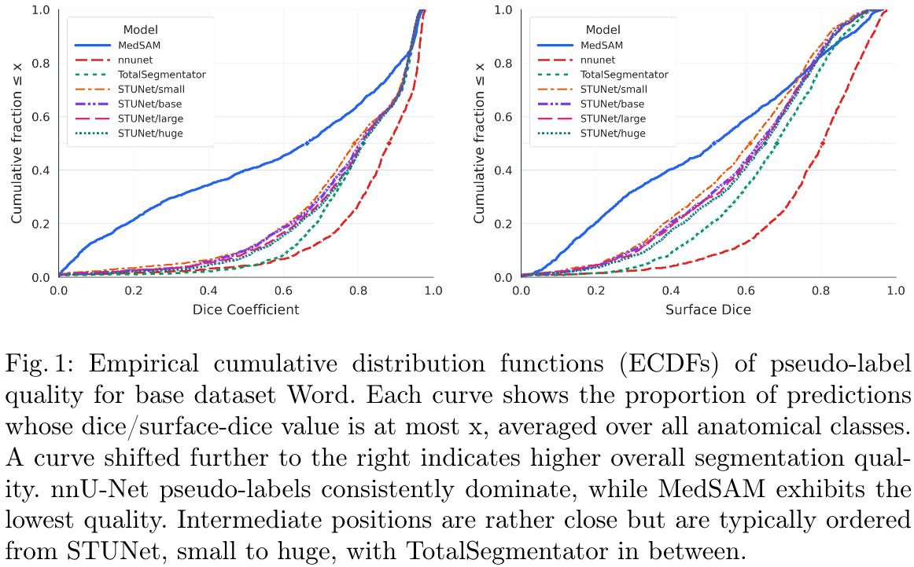
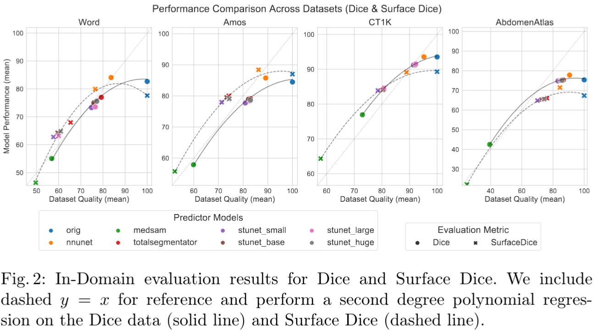
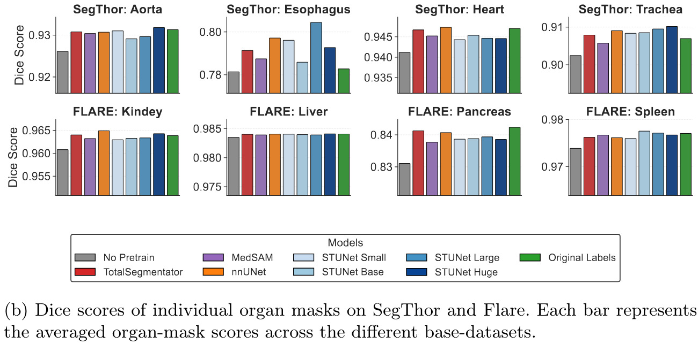
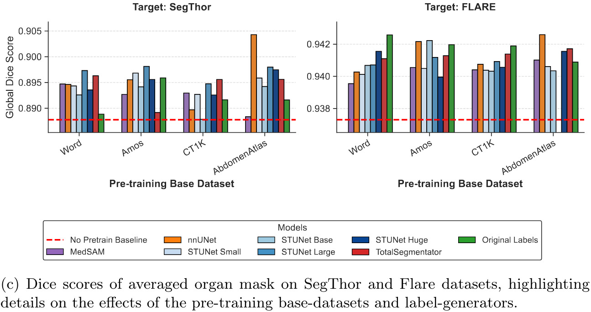

# Highlights

First benchmark of the impact of segmentation label quality in pre-training datasets, to answer the questions:
- Whether better labels lead to better pre-training;
- Whether "human-in-the-loop refinement" is necessary for massive pre-training corpora.

# Introduction

The trend in modern datasets is towards bigger and bigger datasets, up to scales where manual annotations are infeasible.
Automatic or semi-automatic pipelines have been implemented to deliver high-quality masks at scale:
- DAP-Atlas[^1]: Algorithmic checks, requiring experts only for validation
- TotalSegmentator[^2]: Human-in-the-loop refinement
- AbdomenAtlas[^3] [^4]: Uncertainty-based automatic detection of masks to correct

The authors contextualize their work in the broader **label-noise** literature. They claim that previous works typically suffer from limitations, including but not limited to:
- Methodological works propose models adapted to noise, while in practice researchers train standard models on datasets out-of-the-box;
- Noisy labels are typically synthesized using morphological operations, which introduce assumptions about the types of errors.

Thus, no previous study has looked at the impact of **prior-less label-noise** given a **fixed model architecture**.

# Methods

1. > Simulate the construction of modern large-scale datasets by replacing high-quality ground-truth labels with predictions from a diverse suite of [7] models: [nnU-Net, STU-Net (small, base, large, huge), MedSAM, and TotalSegmentator].

    These models were chosen to represent 3 categories of pseudo-label generators:
    1. Standard trainable networks (nnU-Net)
    2. Out-of-the-box foundation models (TotalSegmentator and STU-Net family[^5])
    3. Interactive foundation models (MedSAM)

2. Train models on the previous models' predictions, to simulate training on noisy, imperfect labels.

## Pseudo-labels Quality

In the paper, Table 1 reports overall pseudo-label quality metrics on all 4 datasets, showing the same trends between models across all datasets.

According to the authors, MedSAM's relatively poor performances are because the model is natively 2D, and 3D volumes are achieved simply by stacking 2D predictions.
These poor labels are not inherently an issue, rather the authors consider them representative of potential "low-quality slice-based labels".

# Data

Models are (pre-)trained on 4 abdominal datasets. For in-domain experiments, these same datasets are also used for evaluation.

| Dataset                | Nb of cases | Nb of anatomical structures |
|------------------------|:-----------:|:---------------------------:|
| WORD[^6]               |     100     |              16             |
| AMOS[^7]               |     200     |              15             |
| CT-1K[^8]              |    1,000    |              4              |
| AbdomenAtlas[^3] [^4]  |    5,200    |              9              |

For pre-training experiments, models pre-trained on the above 4 datasets before being finetuned on 2 clean target datasets. The paper does not detail whether the evaluation was performed on the official hold-out tests sets, or using cross-validation on the public train sets.

| Dataset     |             Nb of cases            | Nb of anatomical structures |
|-------------|:----------------------------------:|:---------------------------:|
| SegTHOR[^9] |          40 train, 20 test         |              4              |
| FLARE[^10]  | 361 train, 50 validation, 100 test |              4              |

# Results

## Experimental Setup

Two evaluation scenarios:
- > **In-dataset performance against the dataset’s clean base version**:\
Scenario [representing cases where] no manual ground-truth annotations are accessible for training, such that models may be trained solely on pseudo-labels.
- > **Pretraining on the noisy data followed by finetuning on an independent, high-quality dataset**

Important details regarding training and evaluation setup:
- The model architecture used is DynUnet (nnU-Net's backbone).
- Training hyperparameters are set to be constant across runs, and generally follow nnUNet's setup (e.g. resampling preprocessing).
- Cross-validation is used for evaluation, using 80/20 training/evaluation splits.

## In-Domain Evaluation

From the in-domain results, the authors draw the following (intuitive) conclusions:
- There is a (global) positive correlation between dataset quality and model performance;
    * The trend is not strictly monotonic between models with closer label quality.
- This correlation is non-linear; diminishing returns as quality gets closer to original labels;
- Scale of data can compensate poorer label quality; performance plateaus with lower quality pseudo-label on the largest dataset (AbdomenAtlas)

## Pre-training Suitability

Subplots (b) and (c) from Figure 3, reporting pre-training evaluation results. Subplot (a), not shown here, details statistical significance compared to "No Pretrain" baseline.

From the finetuning results, the authors conclude that:
- Pre-trained models significantly outperform non-pretrained baselines in the "vast majority" of settings;
    * This finding holds when increasing the number of training steps in baselines to equal that of pre-training + finetuning.
- The quality of pseudo-labels does not appear to matter for pre-training; improvements from noisy MedSAM pseudo-labels are comparable to those from higher quality pseudo-labels;
- Perhaps surprisingly, the size of the pretraining dataset is not proportional to the improvement over the baseline, i.e., pre-training on the largest dataset (AbdomenAtlas) did not lead to greater improvements over the baseline.

# Conclusions

- > High label quality is essential for in-domain deployment
- > Fine-tuning effectively compensates for noisy pre-training labels
    * > Suggests that pretraining primarily transfers general structural knowledge rather than precise details

# Editorial Comments

- Four datasets are used (plus two for finetuning applications), but they all cover the same application of abdominal CTs. Thus, no results about whether the conclusions generalize to other modalities/applications.
- No statistics regarding inter- or intra-expert variability, to compare to pseudo-labels accuracy. While the improvements are statistically significant, it is not clear whether they are clinically significant.
    * E.g., in-domain evaluation seemed to show that models trained on nnU-Net pseudo-labels performed even better than models trained on original labels. nnU-Net accuracy being within inter/intra-expert variability could explain this otherwise puzzling result.
- No comparison with self-supervised pre-training baselines, to investigate whether performance improvements come from pseudo-labels or just from having access to more raw data.

# References

[^1]: [Jaus *et al.*: "Towards unifying anatomy segmentation: Automated generation of a full-body ct dataset." IEEE International Conference on Image Processing (ICIP) (2024)](https://arxiv.org/pdf/2307.13375)
[^2]: [Wasserthal *et al.*: "Totalsegmentator: robust segmentation of 104 anatomic structures in ct images." Radiology: Artificial Intelligence (2023)](https://pmc.ncbi.nlm.nih.gov/articles/PMC10546353/pdf/ryai.230024.pdf)
[^3]: [Li *et al.*: "How Well Do Supervised 3D Models Transfer to Medical Imaging Tasks?" International Conference on Learning Representations (ICLR) (2024)](https://www.cs.jhu.edu/~zongwei/publication/li2023suprem.pdf)
[^4]: [Qu *et al.*: "AbdomenAtlas-8K: Annotating 8,000 CT Volumes for Multi-Organ Segmentation in Three Weeks." NeurIPS (2023)](https://www.cs.jhu.edu/~zongwei/publication/qu2023abdomenatlas.pdf)
[^5]: [Huang *et al.*: "STU-Net: Scalable and Transferable Medical Image Segmentation Models Empowered by Large-Scale Supervised Pre-training." arXiv:2304.06716 (2023)](https://arxiv.org/pdf/2304.06716)
[^6]: [Luo *et al.*: "WORD: A large scale dataset, benchmark and clinical applicable study for abdominal organ segmentation from CT image." Medical Image Analysis (2022)](https://arxiv.org/pdf/2111.02403)
[^7]: [Ji *et al.*: "AMOS: A Large-Scale Abdominal Multi-Organ Benchmark for Versatile Medical Image Segmentation." arXiv:2206.08023 (2022)](https://arxiv.org/abs/2206.08023)
[^8]: [Ma *et al.*: "AbdomenCT-1K: Is Abdominal Organ Segmentation a Solved Problem?" IEEE PAMI (2022)](https://arxiv.org/pdf/2010.14808)
[^9]: [Lambert *et al.*: "SegTHOR: Segmentation of Thoracic Organs at Risk in CT images." International Conference on Image Processing Theory, Tools and Applications (IPTA) (2020)](https://arxiv.org/pdf/1912.05950)
[^10]: [Ma *et al.*: "Fast and Low-GPU-memory abdomen CT organ segmentation: The FLARE challenge." Medical Image Analysis (2022)](https://drive.google.com/file/d/1Pjbh5XJweaQx-av1cns7WMPkOwxyY3jQ/view)